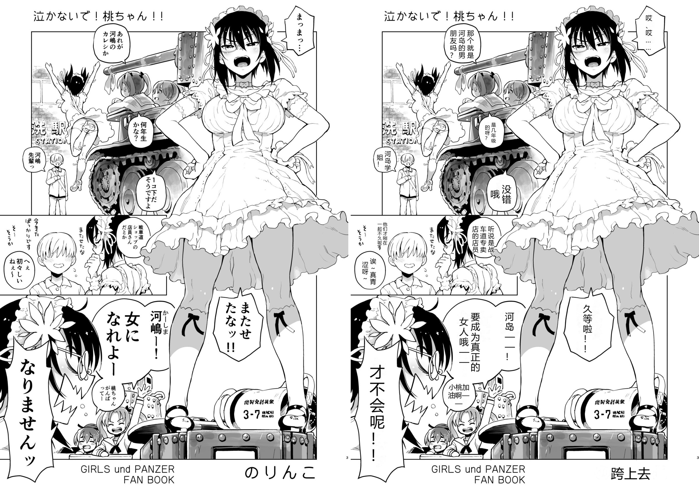
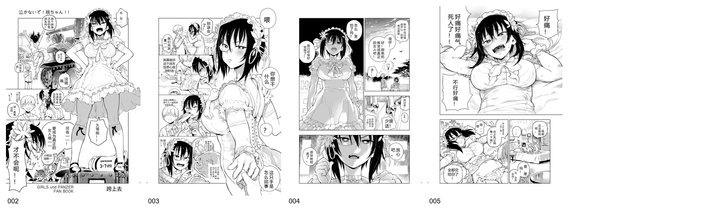

**English** | [中文](README_ZH.md)

# MangaTranslate

**End-to-End Automatic Japanese Manga Translation, Inpainting & Typesetting Pipeline.**

MangaTranslate is a production-ready, modular pipeline designed to translate raw Japanese manga pages into polished, high-resolution Chinese editions. It combines deep-learning text detection, state-of-the-art manga OCR, context-aware LLM dialogue translation, contour-preserving bubble inpainting, and authentic CJK vertical/horizontal typesetting.



---

## Key Features

- **Accurate Bubble & Text Detection**: Powered by YOLOv8 fine-tuned on comic datasets (`comic-speech-bubble-detector`), accurately detecting both oval dialogue bubbles and uncontained text blocks.
- **Manga-Specific Japanese OCR**: Uses `manga-ocr` with custom safetensors loading, running end-to-end on CUDA with sub-400ms latency per bubble.
- **Context-Aware Translation**: Connects to OpenAI-compatible LLM endpoints (e.g. `gemini-3.8-flash-tiered`) with system prompts tailored for manga tone, honorifics, and sound effects, backed by local SHA256 disk caching to eliminate redundant API calls.
- **Contour-Preserving Inpainting**: Employs connected-component analysis inside detected regions to ensure jagged bubble borders and sound effect outlines are never destroyed, cleanly erasing only text glyphs.
- **Authentic CJK Typesetting**: Automatically calculates optimal font size, detects vertical vs. horizontal orientation based on bubble aspect ratio, flows vertical columns right-to-left, and adds subtle contrast strokes for readability. A per-character symbol fallback renders `♡ ♥ ♦ ♣ ♠ ♪ ♬ ✕ ❤` with a dedicated symbol font instead of tofu boxes.
- **Resumable Batch Processing**: Built-in resume capability skips already translated pages, exports structured JSON records (`<stem>.json`) for manual proofreading, and compiles visual contact sheets.

---

## Visual Showcase

### Batch Contact Sheet


---

## Repository Structure

```text
.
├── .gitignore               # Excludes models/, outputs/, .cache/, and raw test assets
├── LICENSE                  # AGPL-3.0
├── README.md                # English documentation
├── README_ZH.md             # Chinese documentation
├── requirements.txt         # Core Python dependencies
├── config.example.json      # Pipeline configuration template
├── mangatranslate/          # Core Python package
│   ├── __init__.py
│   ├── detector.py          # YOLO bubble detection module
│   ├── ocr.py               # Manga-OCR wrapper (safetensors + CUDA)
│   ├── translator.py        # Gemini / OpenAI API client with caching & retries
│   ├── inpainter.py         # Boundary-safe text removal
│   ├── typesetter.py        # Auto font-size fitting & CJK layout engine
│   ├── pipeline.py          # Full page & batch coordinator
│   └── utils.py             # Unicode image IO, reading-order sorting
├── scripts/
│   ├── translate.py         # Primary CLI interface (single page / batch)
│   ├── check_setup.py       # Diagnostic script for dependencies & API
│   ├── download_models.ps1  # Automated model weight downloader
│   └── make_contact_sheet.py# Grid contact sheet generator
├── fonts/
│   └── README.md            # Guidance on system and open-source CJK fonts
└── examples/                # Visual examples for documentation
```

---

## Requirements

- **OS**: Windows 10/11 or Linux
- **Python**: 3.10+
- **GPU**: NVIDIA GPU with 4GB+ VRAM recommended (tested on RTX 3060 Laptop 6GB); CPU inference is also supported.
- **Translation API**: An OpenAI-compatible API gateway (e.g. local gateway at `http://127.0.0.1:8045/v1` with `gemini-3.8-flash-tiered` or any OpenAI-compatible service).

---

## Quick Start

### 1. Install Dependencies

```powershell
python -m pip install -r requirements.txt
```

### 2. Download Model Weights

Download the pre-trained bubble detector and manga OCR weights into the local `models/` directory:

```powershell
.\scripts\download_models.ps1
```

### 3. Run Diagnostics

Verify that all dependencies, CUDA acceleration, local weights, and the translation API gateway are reachable:

```powershell
python scripts/check_setup.py --config config.example.json
```

### 4. Translate a Single Page

```powershell
python scripts/translate.py `
  --input "path/to/page.jpg" `
  --output "outputs/single_test"
```

### 5. Translate an Entire Directory (Batch Mode)

```powershell
python scripts/translate.py `
  --input "path/to/manga_chapter/" `
  --output "outputs/chapter_01" `
  --glob "*.jpg" `
  --contact-sheet
```

---

## Configuration & CLI Parameters

Parameters can be configured in `config.example.json` or overridden via CLI arguments:

| CLI Option | Config Field | Default | Description |
|---|---|---:|---|
| `--input`, `-i` | - | *Required* | Path to input image file or directory |
| `--output`, `-o` | `pipeline.output_dir` | `outputs/` | Target directory for translated outputs |
| `--config`, `-c` | - | `config.example.json` | Path to JSON configuration file |
| `--api-base` | `api.base_url` | `http://127.0.0.1:8045/v1` | OpenAI-compatible endpoint URL |
| `--api-key` | `api.api_key` | - | API authorization key |
| `--model` | `api.model` | `gemini-3.8-flash-tiered` | LLM translation model name |
| `--device` | `detector.device` | `cuda` | Hardware device (`cuda` or `cpu`) |
| `--font` | `typesetter.font_path` | `msyh.ttc` | Custom TTF/TTC font path |
| `--glob` | - | `*.jpg` | File pattern when input is a directory |
| `--force` | - | `false` | Re-translate files that already exist in output |
| `--no-qa` | `pipeline.save_qa` | `false` | Disable side-by-side QA image generation |
| `--no-json` | `pipeline.save_json` | `false` | Disable intermediate JSON metadata export |
| `--contact-sheet` | - | `false` | Compile a contact sheet of all batch pages |

`typesetter.font_path` selects the main CJK font used for Chinese text (Windows defaults to Microsoft YaHei). A per-character symbol fallback is applied automatically for `♡ ♥ ♦ ♣ ♠ ♪ ♬ ✕ ❤`: Segoe UI Symbol (`seguisym.ttf`) on Windows, or DejaVu Sans / Noto Sans Symbols 2 on Linux. As a result, `♡♥♦` no longer turn into `口` boxes, with no extra configuration required.

---

## Output Artifacts

For each translated page `<stem>.jpg`, the pipeline generates:
- `outputs/<stem>.png`: Full-resolution final translated page.
- `outputs/json/<stem>.json`: Detailed coordinates, detected Japanese original, and Chinese translations for manual editing.
- `outputs/qa/<stem>_compare.jpg`: Side-by-side comparison image for fast quality inspection.
- `outputs/summary.json`: Batch timing and page status log.

---

## Troubleshooting

- **`check_setup.py` reports API connection failure**:
  Ensure your local LLM gateway is active at `http://127.0.0.1:8045/v1` and that your upstream internet connection is healthy.
- **PyTorch / Transformers `torch.load` security error**:
  `manga-ocr-base` uses `model.safetensors` to comply with PyTorch 2.5+ security standards. If you download weights manually, ensure `model.safetensors` is present in `models/ocr/manga-ocr-base/`.
- **CJK Font Not Found**:
  By default, Windows system fonts (`C:\Windows\Fonts\msyh.ttc`) are used. On Linux or custom environments, specify `--font /path/to/font.ttf`.
- **A symbol still shows as a box (`口`)**:
  The built-in fallback covers `♡ ♥ ♦ ♣ ♠ ♪ ♬ ✕ ❤`. If another symbol is missing, add it to `SYMBOL_FALLBACK_CHARS` in `mangatranslate/typesetter.py` and make sure a symbol font is available (`seguisym.ttf` on Windows, `DejaVuSans.ttf` or `NotoSansSymbols2-Regular.ttf` on Linux).

---

## License

- Code in this repository is licensed under **AGPL-3.0** (see `LICENSE`).
- Model weights (`manga-ocr`, YOLO bubble detector) and external fonts remain subject to their respective upstream licenses.
