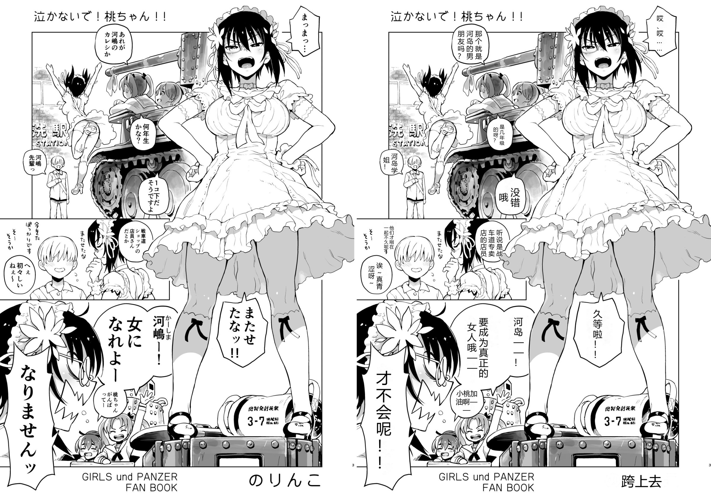
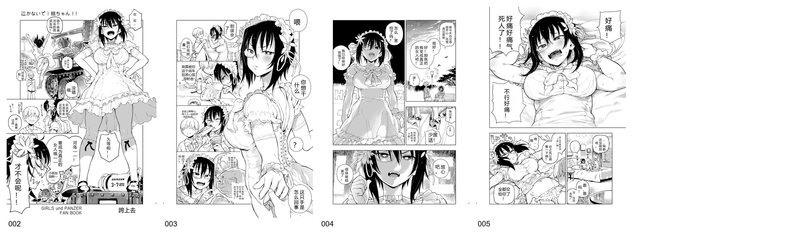

[English](README.md) | **中文**

# MangaTranslate 日漫自动汉化嵌字流水线

**基于深度学习与大语言模型的全自动日漫翻译、擦除填补与排版嵌字流水线。**

MangaTranslate 是一套工业级、高画质的日漫自动汉化流水线工具。针对生肉日文漫画（RAW），它将深度学习气泡与文字检测、高精度日漫专有 OCR（manga-ocr）、上下文感知的大模型台词翻译（Gemini 3.8 Flash 等）、轮廓保护型气泡修图（Inpainting），以及自适应字号与行列流式的 CJK 竖排/横排嵌字引擎完美结合，实现生肉漫画一键汉化。



---

## 核心特性

- **高精度气泡与独立文字检测**：基于在漫画数据集精调的 YOLOv8 模型（`comic-speech-bubble-detector`），精准捕获椭圆对白气泡、矩形框以及无框手写独立文字（text_free）。
- **专有日漫 OCR（Manga-OCR）**：集成 `manga-ocr-base` 模型，采用定制 safetensors 权重加载方案，彻底规避 PyTorch 2.5+ 安全限制；CUDA 全流程加速，单气泡识别耗时仅 300~400ms。
- **语境感知的拟真台词翻译**：对接兼容 OpenAI 接口规范的本地或云端大模型网关（如 `gemini-3.8-flash-tiered`），内置汉化组级 Prompt，精准把握角色语气、傲娇/惊慌声调、敬语及拟声拟态词；配合本地 SHA256 磁盘级翻译缓存，杜绝重复请求消耗。
- **气泡轮廓保护型修字修图（Inpainting）**：运用连通域分析（Connected Components Analysis）滤除外围气泡线与画作边缘，即便面对爆炸框、锯齿边框或特殊效果框，也能在完整保留原始气泡外形的前提下彻底清除日文字迹，无白块破坏。
- **地道 CJK 动态嵌字引擎**：
  - 根据气泡长宽比智能切换竖排（从右向左列流式）与横排布局；
  - 基于二分评估算法自适应寻找填满气泡的最佳字号；
  - 自动规避标点置顶（避头尾法则）；
  - 支持自适应背景感知反色与抗混叠对比度文字描边（White Stroke）。
- **断点续翻与批量生产**：内置 Resume 续翻机制，跳过已生成页面；自动导出结构化中间数据（`<stem>.json`）供人工校对修肉；支持并行生成左右对照 QA 质量走查图及全话缩略图展板（Contact Sheet）。

---

## 效果展示

### 批量汉化全话展板（Contact Sheet）


---

## 代码库目录结构

```text
.
├── .gitignore               # 严格排除 models/、outputs/、.cache/ 及本地测试原图
├── LICENSE                  # AGPL-3.0 开源协议
├── README.md                # 英文说明文档
├── README_ZH.md             # 中文说明文档
├── requirements.txt         # Python 依赖包清单
├── config.example.json      # 流水线全局配置文件模版
├── mangatranslate/          # 核心 Python 模块包
│   ├── __init__.py
│   ├── detector.py          # YOLO 气泡与文本检测模块
│   ├── ocr.py               # Manga-OCR 封装（支持 safetensors 与 CUDA）
│   ├── translator.py        # Gemini / OpenAI API 翻译客户端（带缓存与重试）
│   ├── inpainter.py         # 轮廓保护型文本擦除模块（Telea / NS）
│   ├── typesetter.py        # CJK 竖排横排嵌字与字号自适应引擎
│   ├── pipeline.py          # 单页与批量处理协同调度器
│   └── utils.py             # 宽字符图像读写、阅读顺序重排工具
├── scripts/
│   ├── translate.py         # 核心 CLI 入口（单页翻译 / 目录批处理）
│   ├── check_setup.py       # 环境、硬件加速、本地模型与 API 连通性自检脚本
│   ├── download_models.ps1  # 自动化模型权重下载与格式转换脚本（PowerShell）
│   └── make_contact_sheet.py# 批量汉化结果宫格展板生成工具
├── fonts/
│   └── README.md            # 系统字体与开源漫画中文字体使用说明
└── examples/                # 文档展示对比用例图
```

---

## 环境要求

- **操作系统**：Windows 10 / 11 或 Linux
- **Python 环境**：Python 3.10+
- **显存推荐**：NVIDIA GPU（推荐 4GB 及以上显存，已在 RTX 3060 Laptop 6GB 上实测满速运行）；支持纯 CPU 推理。
- **翻译 API**：兼容 OpenAI API 规范的网关（如运行在 `http://127.0.0.1:8045/v1` 的 `gemini-3.8-flash-tiered` 或外部大模型）。

---

## 快速上手

### 1. 安装 Python 依赖

```powershell
python -m pip install -r requirements.txt
```

### 2. 下载模型权重

运行预设的 PowerShell 脚本，自动从 HuggingFace 镜像源拉取气泡检测模型与 Manga-OCR 权重至本地 `models/` 目录：

```powershell
.\scripts\download_models.ps1
```

### 3. 运行环境与组件自检

快速验证依赖库、CUDA 显卡可用性、本地权重完整性以及翻译 API 接口连通状态：

```powershell
python scripts/check_setup.py --config config.example.json
```

若全部通过，终端将提示 `RESULT: All diagnostic checks passed! READY TO TRANSLATE.`。

### 4. 翻译单张漫画页面

```powershell
python scripts/translate.py `
  --input "example/002.jpg" `
  --output "outputs/single_test"
```

### 5. 批量翻译整话漫画目录

```powershell
python scripts/translate.py `
  --input "example/(C91) 泣かないで! 桃ちゃん!! 1 (別スキャン)" `
  --output "outputs/manga_chapter_01" `
  --glob "*.jpg" `
  --contact-sheet
```

---

## 配置与命令行参数详解

可在 `config.example.json` 中配置默认参数，或在运行 CLI 时传入参数覆盖：

| CLI 参数 | 对应配置项 | 默认值 | 参数说明 |
|---|---|---:|---|
| `--input`, `-i` | - | *必填* | 输入图片路径或包含漫画页面的文件夹路径 |
| `--output`, `-o` | `pipeline.output_dir` | `outputs/` | 汉化生成成果物的输出目录 |
| `--config`, `-c` | - | `config.example.json` | 配置文件路径 |
| `--api-base` | `api.base_url` | `http://127.0.0.1:8045/v1` | 兼容 OpenAI 格式的大模型 API 端点 |
| `--api-key` | `api.api_key` | - | API 认证密钥 |
| `--model` | `api.model` | `gemini-3.8-flash-tiered` | 翻译所使用的大模型名称 |
| `--device` | `detector.device` | `cuda` | 推理设备（`cuda` 或 `cpu`） |
| `--font` | `typesetter.font_path` | `msyh.ttc` | 嵌字所用的中文字体（TTF/TTC） |
| `--glob` | - | `*.jpg` | 输入为目录时的匹配通配符 |
| `--force` | - | `false` | 强制重新翻译已存在输出中的页面 |
| `--no-qa` | `pipeline.save_qa` | `false` | 关闭汉化前后左右对照图（QA）的生成 |
| `--no-json` | `pipeline.save_json` | `false` | 关闭中间 OCR 与翻译元数据 JSON 的导出 |
| `--contact-sheet` | - | `false` | 批处理完成后自动拼合整话展板大图 |

---

## 产出文件说明

在每次批量翻译完成后，输出目录下将包含：
- `outputs/<stem>.png`：高清晰度、无损保存的最终汉化嵌字漫画页。
- `outputs/json/<stem>.json`：记录该页所有气泡坐标、置信度、OCR 原文、中文译文的 JSON 元数据，便于人工二次复审与协同。
- `outputs/qa/<stem>_compare.jpg`：左边原图、右边汉化图的双联画对比图，方便快速质检查验。
- `outputs/summary.json`：全话各页面耗时、气泡数量及状态统计汇总。
- `outputs/contact_sheet.jpg`：多行多列排版的整话汉化总览大图。

---

## 常见问题与排查

1. **`check_setup.py` 报错 API 连通失败**：
   请确认本地翻译网关（如 `http://127.0.0.1:8045/v1`）是否正常启动且端口未被防火墙阻断。
2. **PyTorch / Transformers 报 `torch.load` 安全限制错误**：
   本仓库在 `manga-ocr` 加载时全面采用 safetensors 格式权重，`scripts/download_models.ps1` 会自动执行兼容转换，确保在 PyTorch 2.5+ 环境下免报 CVE 拦截警告。
3. **找不到中文字体或中文乱码**：
   Windows 环境下默认使用系统自带微软雅黑（`C:\Windows\Fonts\msyh.ttc`）。在 Linux 环境部署时，请安装 `fonts-noto-cjk` 或通过 `--font` 指定中文字体路径。

---

## 开源协议

- 本仓库代码遵循 **AGPL-3.0** 开源协议（详见 `LICENSE`）。
- 外部模型权重（`manga-ocr`、`comic-speech-bubble-detector`）以及第三方字体遵循其各自原始许可证。
